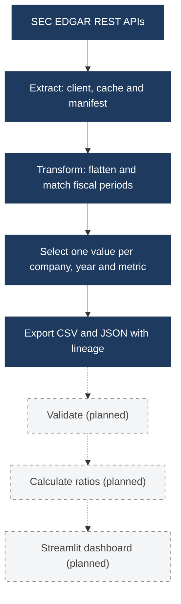

# FinFlow: Automated Financial Statements Data Pipeline


An independent financial data management project. FinFlow is a Python ETL pipeline that acquires company financial statement data from the official SEC EDGAR REST APIs standardises it with Pandas and exports traceable datasets. Automated validation, financial ratios and a dashboard are being added.

> **Status: active development.** Data acquisition, standardisation and CSV exports are implemented, tested and run on real data. The data quality rules, financial ratios and dashboard are **planned**, and are marked as such throughout.
> Not investment advice, not an audit, and not affiliated with the SEC or any company listed.

## Contents
[Business problem](#business-problem) · [Objectives](#objectives) · [Project status](#project-status) · [Verified results](#verified-results) · [Technology](#technology-stack) · [Data source](#data-source-sec-edgar) · [Architecture](#etl-pipeline-architecture) · [Metrics and periods](#financial-metrics-and-reporting-periods) · [Standardisation](#transformation-and-standardisation) · [Data quality](#data-quality-and-validation) · [Financial analysis](#financial-analysis) · [Testing](#testing) · [Structure](#project-structure) · [Getting started](#getting-started) · [Roadmap](#roadmap) · [Limitations](#limitations)

---

## Business problem

Company filings are public, but turning them into comparable data is difficult:

- **Different tags for similar concepts.** Two revenue tags can measure different totals.
- **Different fiscal calendars.** Year ends vary, and some years last 53 weeks.
- **Repeated and revised values.** Each annual filing repeats earlier years, sometimes restated.
- **Misleading labels.** The SEC's `fy` field describes the filing a value came from, not the year it measures.
- **Unreported totals.** Some companies never print a given total, and a missing value is not a zero.

Analysts need figures that are comparable, checked and traceable to the filing they came from.

## Objectives

| Objective | Status |
|---|---|
| Acquire real financial statement data from official REST APIs within SEC fair access rules | ✅ Implemented |
| Match values to fiscal years by their actual dates, keeping filing lineage | ✅ Implemented |
| Standardise seven metrics for 10 companies over three fiscal years | ✅ Implemented (198 of 210 values reported) |
| Detect missing, duplicate, inconsistent and irreconcilable data with automated rules | 📋 Planned |
| Calculate revenue growth, net profit margin and return on equity | 📋 Planned |
| Export CSV and JSON with lineage and a run manifest | ✅ Implemented; validated exports planned |
| Present verified results in a lightweight dashboard | 📋 Planned |

## Project status

| Area | Status | Notes |
|---|---|---|
| SEC API client (rate limit, retries, timeouts) | ✅ Complete | Run on real data |
| Local cache and source manifest (URL, UTC time, SHA-256) | ✅ Complete | Cached reruns make no downloads |
| Flattening of nested JSON into Pandas tables | ✅ Complete | Every candidate fact and source field kept |
| Annual fiscal-period matching | ✅ Complete | Handles 52 and 53-week years and a filing cutoff date |
| Source inspection report | ✅ Complete | Availability, tag agreement and revisions |
| Canonical value selection with conflict and restatement handling | ✅ Complete | One value per company, year and metric |
| Long, wide, supporting and candidate CSV exports, run manifest | ✅ Complete | Published only after a complete run |
| Data quality rules, financial ratios | 📋 Planned | Phase 3 |
| Full run including validation and ratios, final documentation | 📋 Planned | Phase 4 |
| Streamlit dashboard | 📋 Planned | Phase 5 |

## Verified results

Measured on **2026-11-24** with data retrieved that day and the same filing cutoff. Real-data and synthetic-test results are reported separately.

**Real SEC data (FY2023 to FY2025)**

| Measure | Result |
|---|---|
| Companies retrieved | 10 of 10 |
| SEC source files, with checksums | 25 (43.8 MB) |
| Candidate facts flattened (all available years, configured tags) | 16,726 |
| Eligible candidates for FY2022 to FY2025 | 807 |
| Selected core values | 198 of 210 (94.3%) |
| Company-year rows | 30 of 30 |
| Unresolved conflicts | 0 |
| Missing slots | 12 (total liabilities for AMZN, KO, WMT; parent equity for PG) |
| Selected values (core and support) traced to raw SEC JSON by separate code | 344 of 344 |
| Values compared with 10-K documents (nine company-years) | 59 of 59 matched |
| Cached `run`: extract and transform stages | 0.3 s and 0.5 s |
| Cached rerun | All four CSV files identical byte for byte |

The quality rules have not run yet, so exports are marked `not_validated`. The 10-K comparison is a sample; META and MSFT filings have not been compared.

**What the real data showed**

- **Walmart's revenue tags disagree.** For fiscal 2025, `Revenues` is $680,985m and contract revenue is $674,538m. The $6,447m difference equals the printed "Membership and other income" line, so the total takes priority.
- **Stock splits restate EPS.** NVIDIA's fiscal 2023 diluted EPS was first reported as $1.74 and later as $0.17 after a ten-for-one split.
- **Some totals are not reported.** AMZN, KO and WMT have no total liabilities fact, and PG reports only total equity including noncontrolling interests. These stay missing.
- **Balance sheets reconcile where they can be checked.** In an exploratory check over FY2022 to FY2025, 27 of 28 company-years balanced exactly. The other differs by $1m, consistent with rounding.

Details, filing links and unchecked items: [docs/verification.md](docs/verification.md)

**Synthetic test data**

| Measure | Result |
|---|---|
| Automated tests | 56 of 56 passed |
| Deliberate code breakages caught (one-off checks, Phases 1 and 2) | 23 of 23 |

## Technology stack

| Layer | Technology | Status |
|---|---|---|
| Language | Python 3.12 (3.11+ required) | In use |
| Data acquisition | `requests`, SEC EDGAR REST APIs (JSON) | In use |
| Transformation | `pandas` | In use |
| Configuration | JSON files, `python-dotenv` | In use |
| Command line, logging, files | Standard library (`argparse`, `logging`, `pathlib`) | In use |
| Testing | `pytest` | In use |
| Dashboard | Streamlit | Planned |

## Data source: SEC EDGAR

| Endpoint | Used for |
|---|---|
| [`company_tickers.json`](https://www.sec.gov/files/company_tickers.json) | Finding each company's CIK (SEC identifier) instead of guessing it |
| `data.sec.gov/api/xbrl/companyfacts/CIK##########.json` | Reported XBRL financial facts |
| `data.sec.gov/submissions/CIK##########.json` | Filing history, report dates and document links |

Documentation: [EDGAR APIs](https://www.sec.gov/search-filings/edgar-application-programming-interfaces) · [Developer and fair access guidance](https://www.sec.gov/about/developer-resources)

**Responsible access:** one request at a time, at most two per second (the SEC limit is ten). Clients declare a contact in the User-Agent. Temporary failures are retried a limited number of times, `Retry-After` is respected, and refusals such as HTTP 403 are never retried. Raw downloads are not committed.

## ETL pipeline architecture



Dark steps are implemented. Light, dashed steps are planned; validation and ratios will run before the final exports.

**Design choices**
- **Lineage:** responses are saved byte for byte, and each fact keeps its tag, unit, dates, form, filing date and accession number.
- **Integrity:** a cached file whose checksum changes is downloaded again, and a failed refresh never replaces a good file.
- **Honest failure:** if any company fails, the run is reported as incomplete with a non-zero exit code.
- **Simplicity:** readable functions, with no database, API server or orchestration framework.

## Financial metrics and reporting periods

**Companies:** AAPL, MSFT, NVDA, GOOGL, AMZN, META, TSLA, KO, WMT, PG.
**Periods:** fiscal years 2023 to 2025 on each company's own calendar. Fiscal 2022 is retrieved only as prior-year support.

| Metric | US-GAAP tags, in priority order | Unit | Period |
|---|---|---|---|
| Revenue | `Revenues`, `RevenueFromContractWithCustomerExcludingAssessedTax` | USD | Full year |
| Net income (parent) | `NetIncomeLoss` | USD | Full year |
| Total assets | `Assets` | USD | Year end |
| Total liabilities | `Liabilities` | USD | Year end |
| Shareholders' equity (parent) | `StockholdersEquity` | USD | Year end |
| Operating cash flow | `NetCashProvidedByUsedInOperatingActivities` | USD | Full year |
| Diluted EPS | `EarningsPerShareDiluted` | USD/shares | Full year |

Four supporting balance sheet fields are collected for reconciliation and are not counted in these seven. The mapping and its reasons are versioned in [`config/metrics.json`](config/metrics.json).

Fiscal years are not the same calendar period: fiscal 2025 ended on 26 January 2025 for NVDA and on 31 December 2025 for GOOGL.

## Transformation and standardisation

1. Flatten every configured fact into one Pandas row with all source fields.
2. Find each company's 10-K and 10-K/A filings, including older pages of its filing history.
3. Match facts by actual dates, never by `fy` alone. A duration of 350 to 380 days is annual; quarterly and year-to-date values are excluded.
4. Keep only the expected unit, eligible annual forms and facts filed by the cutoff date.
5. Compare candidate tags side by side and label each slot as missing, agreeing, disagreeing or revised.

6. Select one value per company, period and metric: documented tag priority, then the latest eligible filing. Conflicts are flagged rather than guessed.
7. Export a long table of facts with lineage and a wide company-year table.

Example rows from the real `company_financials.csv` (columns shortened, USD millions here; exports hold unscaled values):

| Ticker | Fiscal year | Period end | Revenue | Net income | Total liabilities | Missing |
|---|---|---|---|---|---|---|
| AAPL | 2024 | 2024-09-28 | 391,035 | 93,736 | 308,030 | |
| WMT | 2025 | 2025-01-31 | 680,985 | 19,436 | *(empty)* | total_liabilities |


Zero and negative reported values are kept. Missing values are never replaced with zero. Details: [methodology](docs/methodology.md) · [data dictionary](docs/data_dictionary.md)

## Data quality and validation

**Implemented safeguards in extraction and transformation:** JSON check before saving, checksum verification, duplicate-key and conflict checks, unit and annual-form filters, filing cutoff, annual-duration check, and reporting of missing slots, tag disagreements and revised values.

**Planned rule framework (Phase 3)**

| Rule | Purpose |
|---|---|
| Q01 Required identifiers | Reject a missing CIK, ticker or period |
| Q02 Expected coverage | Flag missing metric slots |
| Q03 Uniqueness | Detect duplicate company, period and metric keys |
| Q04 Numeric values | Reject non-numeric or non-finite values |
| Q05 Units | Reject the wrong currency or per-share unit |
| Q06 Fiscal period | Reject mismatched durations or dates |
| Q07 Filing eligibility | Exclude unsupported forms and late filings |
| Q08 Candidate conflicts | Flag unresolved conflicting values |
| Q09 Accounting identity | Compare assets with liabilities plus equity |
| Q10 Denominators | Skip unsuitable ratios, with a reason |
| Q11 Lineage | Flag missing source details |

The design separates errors (excluded), warnings (kept and flagged) and checks that could not be evaluated, which will not count as passes.

## Financial analysis

📋 **Planned (Phase 3).** No ratios have been calculated yet.

| Measure | Formula |
|---|---|
| Revenue growth | (current revenue − prior revenue) ÷ prior revenue × 100 |
| Net profit margin | net income ÷ revenue × 100 |
| Return on equity | parent net income ÷ average of opening and closing parent equity × 100 |

Missing inputs or unsuitable denominators will give an empty result with a reason.

## Testing

```bash
python -m pytest
```

**Last result (2026-11-24): 56 of 56 passed.** Tests use synthetic data and block network connections. They cover:

- **Extraction:** request spacing, retries and back-off, `Retry-After`, permanent failures, caching, checksum changes and contact checks.
- **Transformation:** quarterly and annual values, 52 and 53-week years, comparative values, amendments, cutoff dates, wrong units, and zero, negative and missing values.
- **Selection and exports:** repeated values, restatements, tag priority, conflicts, duplicate keys, identical reruns, and incomplete runs that must not replace good data.
- **Command line:** repeatable runs, partial failure and missing configuration.

## Project structure

```text
finflow/
├── config/
│   ├── companies.json        # tickers in scope
│   └── metrics.json          # versioned metric-to-tag mapping
├── finflow/
│   ├── extract.py            # SEC client, cache and source manifest
│   ├── transform.py          # flattening, period matching and selection
│   ├── pipeline.py           # run stages and safe publication
│   ├── inspect_source.py     # source inspection report
│   └── __main__.py           # command line
├── tests/                    # pytest suite and synthetic fixtures
├── docs/                     # methodology, data dictionary, verification
├── data/                     # raw and processed data (not committed)
├── .env.example              # configuration template
├── pytest.ini
└── requirements.txt          # pinned dependencies
```

## Getting started

Requires Python 3.11 or later (tested with 3.12).

```bash
git clone https://github.com/Y0sola/finflow.git
cd finflow
python3.12 -m venv .venv
source .venv/bin/activate
pip install -r requirements.txt
python -m pytest
```

To retrieve real data, create a local `.env` and replace the placeholder with your own contact email. It is ignored by Git and sent only to the SEC.

```bash
cp .env.example .env
```

Run the pipeline for all ten companies. Exports go to `data/processed/`:

```bash
python -m finflow run --as-of 2026-11-24
```

Inspect one company's source data:

```bash
python -m finflow inspect --tickers AAPL --as-of 2026-11-24
```

Inspect all ten companies, with fiscal 2022 as support:

```bash
python -m finflow inspect --start-year 2022 --as-of 2026-11-24
```

Inspection results are saved to `data/inspection/source_inspection.csv`. Later runs use the cache; add `--refresh` to download again.
Exit codes: `0` all companies succeeded, `1` at least one failed, `2` setup or source error.

## Roadmap

- [x] **Phase 1:** setup, SEC acquisition, period matching and source inspection
- [x] **Phase 2:** canonical value selection, lineage, long and wide exports
- [ ] **Phase 3:** data quality rules, financial ratios, wider comparison with filings
- [ ] **Phase 4:** end-to-end run, repeatability checks, data dictionary and methodology
- [ ] **Phase 5:** Streamlit dashboard and screenshots
- [ ] Optional: continuous integration and dashboard hosting

## Limitations

- The company facts API covers standard taxonomy tags, so company-specific tags may be absent.
- Latest-known values can include revisions, so this is not a point-in-time dataset.
- Tag mappings were checked against a sample of filings, not all of them.
- EPS from before a stock split may not be comparable if no later filing restated it.
- Banks and insurers are excluded because their statements are presented differently.
